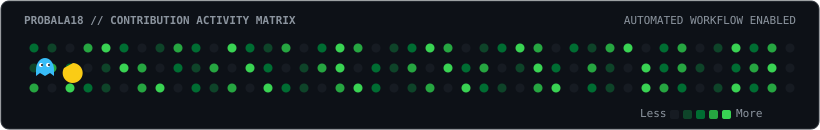

<div align="center">

<!-- Hero Animated Terminal Banner -->
<a href="https://github.com/probala18">
  
</a>

<br/>

<!-- Dynamic Terminal Typing Line -->
<a href="https://github.com/probala18">
  
</a>

<br/>

<!-- Verified Identity & Social Badges -->
<p align="center">
  <a href="https://github.com/probala18" target="_blank">
    
  </a>
  &nbsp;
  <a href="https://www.linkedin.com/in/bala-sundar-5a86b4353" target="_blank">
    
  </a>
  &nbsp;
  <a href="mailto:balasundar0307@gmail.com">
    
  </a>
</p>

</div>

---

### `$ cat identity.env`

> Hi, I'm **Balasundar** — an Artificial Intelligence & Data Science student building modern web applications and AI-powered tools. I work across the stack with **React**, **Next.js**, **TypeScript**, and **Python**, focusing on hands-on project implementations involving **LLMs**, **RAG pipelines**, and **autonomous agent workflows**.

```text
┌── [USER_INFO]
│   ├── Handle     : probala18
│   ├── Field      : Artificial Intelligence & Data Science
│   ├── Direction  : Frontend Engineering × AI Software Development
│   └── Philosophy : Grounded implementations, clean UX, and verifiable architectures
└── [SYSTEM_STATUS]
    └── Mode       : Active development & open-source project shipping
```

---

### `$ ls -la ~/skills-matrix/`

#### 🖥️ Frontend Engineering
<p align="left">
  <a href="https://skillicons.dev">
    
  </a>
</p>

- **Core Frameworks:** React 18, Next.js, TypeScript, JavaScript (ES6+), Vite
- **UI & Motion:** Tailwind CSS, Framer Motion, GSAP (ScrollTrigger), Radix UI / Shadcn

#### 🧠 AI & Data Science
<p align="left">
  <a href="https://skillicons.dev">
    
  </a>
  
  
  
</p>

- **AI Implementations:** LLM Application Development, Page-Aware RAG, Atomic Citation Validation
- **Agent Workflows:** Multi-Agent Pipelines, Deterministic Triage, ChromaDB & Vector Retrieval
- **Core Scientific:** NumPy, Pandas, scikit-learn, Sentence Transformers (`all-MiniLM-L6-v2`)

#### ⚙️ Backend, Persistence & Tooling
<p align="left">
  <a href="https://skillicons.dev">
    
  </a>
</p>

- **Backend Runtime:** FastAPI (Python), Node.js, Express, TSX, REST APIs
- **Databases & ORM:** SQLite (`better-sqlite3`, SQLAlchemy), Drizzle schema design
- **Developer Workflow:** Git, GitHub, VS Code, Linux environments, Docker basics

---

### `$ git log --graph --oneline ~/featured-projects`

<table>
  <thead>
    <tr>
      <th width="32%">Project Repository</th>
      <th width="48%">Architecture &amp; Description</th>
      <th width="20%">Tech Stack</th>
    </tr>
  </thead>
  <tbody>
    <tr>
      <td>
        <a href="https://github.com/probala18/CiteTrace"><b>CiteTrace</b></a><br/>
        <sub>⚡ Evidence Intelligence &amp; Claim Verifier</sub>
      </td>
      <td>
        Full-stack RAG starter MVP for evidence-grounded document Q&amp;A. Ingests PDF/DOCX files, preserves page references, indexes chunks with local <code>all-MiniLM-L6-v2</code> embeddings, generates atomic claims, and validates citations with verifiable labels (<code>supported</code>, <code>contradicted</code>, <code>unverified</code>).
      </td>
      <td>
        <code>FastAPI</code><br/>
        <code>Sentence-TF</code><br/>
        <code>SQLite</code><br/>
        <code>Next.js</code><br/>
        <code>TypeScript</code>
      </td>
    </tr>
    <tr>
      <td>
        <a href="https://github.com/probala18/lifepilot-ai"><b>LifePilot AI</b></a><br/>
        <sub>🤖 Autonomous Multi-Agent Personal Assistant</sub>
      </td>
      <td>
        Personal intelligence platform designed to eliminate cognitive overload. Operates a deterministic triage pipeline across three domain agents (Personal Assistant, Shopping Decision Engine, Symptom Analyzer) with local SQLite persistence and cron-driven background notification dispatch.
      </td>
      <td>
        <code>React</code><br/>
        <code>Vite</code><br/>
        <code>TypeScript</code><br/>
        <code>Express</code><br/>
        <code>better-sqlite3</code>
      </td>
    </tr>
    <tr>
      <td>
        <a href="https://github.com/probala18/climateFusionX"><b>ClimateFusionX</b></a><br/>
        <sub>📊 Climate Trends &amp; Indian Weather Analytics</sub>
      </td>
      <td>
        Full-stack analytics workspace featuring multi-horizon climate forecasting (temperature, CO₂, sea level) and city-level exploration across 10 major Indian cities. Powered by a 7,890-record meteorological dataset, seasonal presets, comparative charts, and CSV data export.
      </td>
      <td>
        <code>React 18</code><br/>
        <code>TypeScript</code><br/>
        <code>Vite</code><br/>
        <code>Recharts</code><br/>
        <code>Tailwind CSS</code>
      </td>
    </tr>
    <tr>
      <td>
        <a href="https://github.com/probala18/knowDeX"><b>knowDeX</b></a><br/>
        <sub>📚 Academic AI Study Companion</sub>
      </td>
      <td>
        Academic intelligence workspace supporting document-grounded study workflows. Integrates document processing, RAG-style chat over course materials, automatic lecture summaries, and interactive flashcard/quiz generation.
      </td>
      <td>
        <code>Next.js</code><br/>
        <code>React</code><br/>
        <code>FastAPI</code><br/>
        <code>SQLAlchemy</code><br/>
        <code>ChromaDB</code>
      </td>
    </tr>
  </tbody>
</table>

---

### `$ telemetry --display=activity`

<!-- Pac-Man Contribution Graph -->
<div align="center">
  <picture>
    <source media="(prefers-color-scheme: dark)" srcset="https://raw.githubusercontent.com/probala18/probala18/output/pacman-contribution-graph-dark.svg">
    <source media="(prefers-color-scheme: light)" srcset="https://raw.githubusercontent.com/probala18/probala18/output/pacman-contribution-graph.svg">
    
  </picture>
</div>

<br/>

<!-- GitHub Metrics & Streak Cards -->
<div align="center">
  <a href="https://github.com/probala18">
    
  </a>
</div>

<br/>

<div align="center">
  <a href="https://github.com/probala18">
    
  </a>
  &nbsp;&nbsp;
  <a href="https://github.com/probala18">
    
  </a>
</div>

---

### `$ ping -c 1 balasundar`

<div align="center">

```text
64 bytes from balasundar0307@gmail.com: icmp_seq=1 ttl=64 time=0.042 ms
--- open to discussions on frontend systems, AI engineering, and project collaborations ---
```

<p align="center">
  <a href="https://github.com/probala18">
    
  </a>
  &nbsp;
  <a href="https://www.linkedin.com/in/bala-sundar-5a86b4353">
    
  </a>
  &nbsp;
  <a href="mailto:balasundar0307@gmail.com">
    
  </a>
</p>

<sub><code>[probala18@system ~]$ exit &bull; Session terminated &bull; 0 errors</code></sub>

</div>

